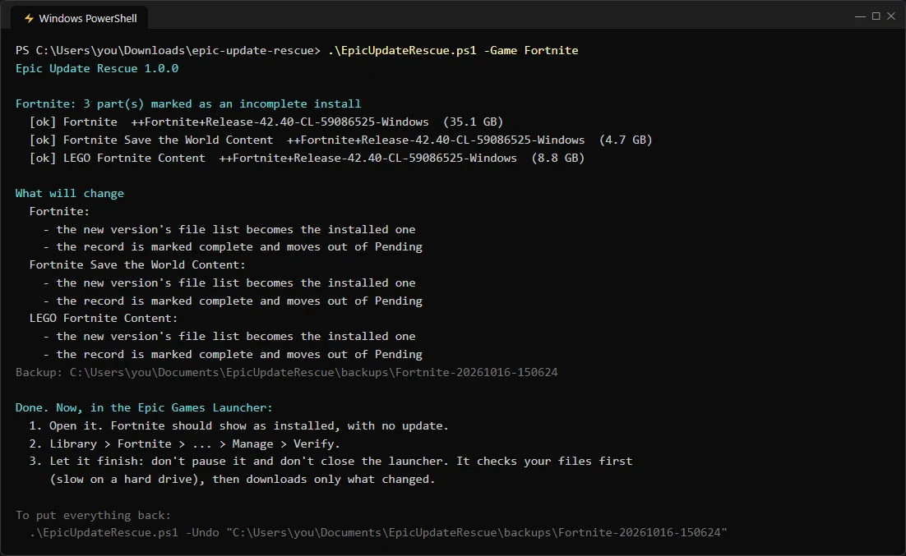
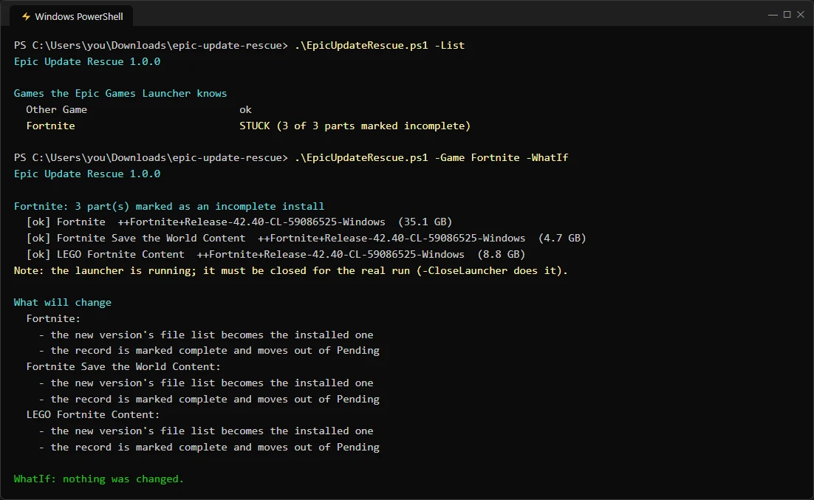

# Epic Update Rescue

**Paused a game update in the Epic Games Launcher, and now it wants to download the whole game again?** This fixes it, so you download only what the update really changed.

You can **fix it by hand in a few minutes** (steps below, nothing to download), or let a small, readable script do the same steps for you, with a backup and an undo.


> **In plain words: what the script does, and what it never does**
> - It changes **one word** (`true` → `false`) in the launcher's record of your game and moves **two of the launcher's own bookkeeping files**. That's all. The manual steps below are exactly the same thing.
> - It **never** touches your game files, **never** connects to the internet, **never** installs anything and has no hidden parts: it's one plain-text file, [`EpicUpdateRescue.ps1`](EpicUpdateRescue.ps1), that you can open in Notepad and read.
> - It **copies every file it changes** to a backup folder first, and `-Undo` puts them back exactly as they were.
> - It's open source (MIT), tested on every change, and not affiliated with Epic Games. The release zip was scanned by **66 antivirus engines on VirusTotal: [0 detections](https://www.virustotal.com/gui/file/65a53cc1fe606204a3035601d13748b5925560f01f4a4c240abc98f03668da48)**.

## The problem

You start an update, then pause it, close the launcher or shut the PC down. Next time, the launcher shows the **full game size** (for example **44.78 GB** for a Fortnite update) and **Verify** is greyed out.

What happened: the launcher moved the game's record to its `Pending` folder and marked it `"bIsIncompleteInstall": true`. From then on it treats the game as a fresh **install**, not an **update**, even though all your files are still there.

The fix: make the launcher see the new version as already installed. Then **Verify** works again: it checks the files you already have and downloads only what's different.

Real case (the reason this exists): Fortnite 42.40 wanted 44.78 GB after a paused update. After the fix, Verify finished in about 35 minutes on a hard drive, downloading only the changes.

## Fix it by hand (no download)

1. **Close the Epic Games Launcher completely**: right-click its icon by the clock → **Exit**. (If it's still running it undoes your changes.)
2. **Open the launcher's records**: paste `C:\ProgramData\Epic\EpicGamesLauncher\Data\Manifests\Pending` into the File Explorer address bar.
3. **Find your game's records**: open each `.item` file with Notepad; the `"DisplayName"` line says which game it is, and `"InstallLocation"` where it's installed. Some games have several parts (Fortnite has 3: Fortnite, Save the World Content, LEGO Fortnite Content); do the next steps for **every part**. Each part's `.item` file name (a long ID) is also the name of its file lists.
4. **Back up first**: copy those `.item` files, and the game's `.manifest` files from `<InstallLocation>\.egstore\` and `<InstallLocation>\.egstore\Pending\`, into a folder of your own (e.g. on the Desktop). `.egstore` is a hidden folder: paste its full path into the address bar.
5. **Swap the file lists**: for each part, copy `.egstore\Pending\<ID>.manifest` into `.egstore\` (replace the old one there), then move the one in `.egstore\Pending\` out to your backup folder.
6. **Change one word**: in each part's `.item`, change `"bIsIncompleteInstall": true,` to `"bIsIncompleteInstall": false,` and save. (If Notepad can't save, open Notepad as administrator first.)
7. **Move the records up**: move each part's `.item` file from `Manifests\Pending\` to `Manifests\` (one folder up).
8. **Open the Epic Games Launcher** → Library → your game → **⋯ → Manage → Verify**, and let it finish without pausing or closing the launcher. It checks your files first (slow on a hard drive), then downloads only what changed.

To undo: close the launcher and put the backed-up files back where they came from (and remove the `.item` files you moved into `Manifests\`).

## Or let the script do it

1. **Download** the latest **[release](https://github.com/naniiic137/epic-update-rescue/releases/latest)** (`EpicUpdateRescue-1.0.0.zip`) and unzip it.
2. Optional, but recommended: **check it's the real file** (see [Check the download](#check-the-download)) and **read it**: `EpicUpdateRescue.ps1` is plain text.
3. **Double-click `Fix-Epic-Update.bat`.** It shows the stuck game(s) and asks before closing the launcher and before changing anything.
4. Then step 8 above: **Verify** in the launcher, and let it finish.



If Windows says it protected your PC, that's because the script isn't code-signed (signing costs money, or needs a sponsor): click **More info → Run anyway**, after reading it if you like.

### From PowerShell

```powershell
.\EpicUpdateRescue.ps1 -List                        # which games are stuck
.\EpicUpdateRescue.ps1 -Game Fortnite -WhatIf       # show what would change, change nothing
.\EpicUpdateRescue.ps1 -Game Fortnite -CloseLauncher
.\EpicUpdateRescue.ps1 -Undo "<the backup folder it printed>"
```

If PowerShell refuses to run scripts: `powershell -ExecutionPolicy Bypass -File .\EpicUpdateRescue.ps1 -List`.



### Check the download

These are the SHA-256 fingerprints of version 1.0.0. If even one character of a file were changed, its fingerprint would be completely different.

| File | SHA-256 |
|---|---|
| `EpicUpdateRescue-1.0.0.zip` | `65A53CC1FE606204A3035601D13748B5925560F01F4A4C240ABC98F03668DA48` |
| `EpicUpdateRescue.ps1` | `D9DD6E983C339347048DC8DD3F8B85BD0B40DEAC73A424D0E962D47F806AED0C` |
| `Fix-Epic-Update.bat` | `4DB47ECD0ACD9B8B3EBC1F883AB7A2879DDCF9988EE447C32451AF2CE26BD280` |

To check, open PowerShell in the folder and run `Get-FileHash .\EpicUpdateRescue-1.0.0.zip` (or the file's name): the long code it prints must match the table.

**Antivirus scan:** the release zip on VirusTotal, **0 of 66** engines flag it: [see the scan](https://www.virustotal.com/gui/file/65a53cc1fe606204a3035601d13748b5925560f01f4a4c240abc98f03668da48).

## What it changes

Only the launcher's bookkeeping files for that game, never the game files:

| File | Where | Change |
|---|---|---|
| The game's record (`<id>.item`, one per part) | `C:\ProgramData\Epic\EpicGamesLauncher\Data\Manifests\Pending\` | `bIsIncompleteInstall` → `false` (nothing else, same encoding), then moved up into `Manifests\` |
| The new version's file list (`<id>.manifest`) | `<game folder>\.egstore\Pending\` | moved to `<game folder>\.egstore\`, replacing the old version's list |

## Safety

- **Backup first**: every file it touches is copied (and checked byte for byte) to `Documents\EpicUpdateRescue\backups\<game>-<date>` with a `restore.json`.
- **Undo**: `-Undo <backup folder>` puts every file back exactly as it was.
- **Refuses rather than guesses**: if the launcher is running (it would overwrite the fix), if a part's new file list isn't on disk yet, or if the game folder is missing. If anything fails half-way, it restores the backup by itself.
- **`-WhatIf`** shows the plan and changes nothing.

## FAQ

**Does it work for games other than Fortnite?** Yes: any Epic Games Launcher game stuck as an incomplete install. `-List` shows what the launcher knows.

**Verify still downloads a lot.** Then the update really is big (some updates change half of a game's files). It's still only what changed, never the whole game.

**"Access denied".** Run it as administrator (right-click the `.bat` → Run as administrator); it restores everything if a write fails.

**How do I avoid this next time?** Don't pause or close the launcher during an update. To keep the PC usable, use the launcher's **Settings → Throttle downloads** instead.

## Tests

`tests\Run-Tests.ps1` builds a fake launcher setup in a temp folder and checks the whole flow: finding stuck games, `-WhatIf`, refusing while the launcher runs, the fix byte for byte, undo restoring everything exactly, unsafe cases, and rolling back a failure half-way. It never touches a real launcher.

```powershell
powershell -NoProfile -ExecutionPolicy Bypass -File tests\Run-Tests.ps1
```

They run on every push (Windows PowerShell 5.1 and PowerShell 7).

## Not affiliated with Epic Games

This is an independent tool. It only edits the launcher's own local files on your PC, the way you could by hand. Use it at your own risk; the backup and `-Undo` are there for that.

## Licence

[MIT](LICENSE) © 2026 Hamza Ben Ismail
